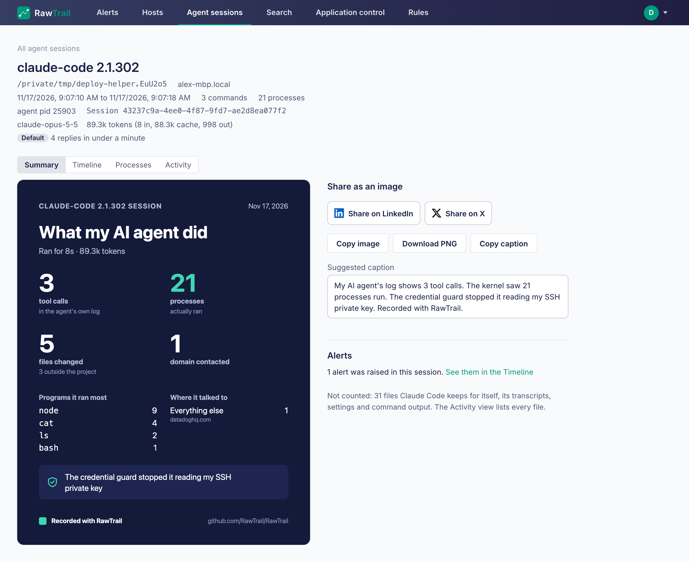
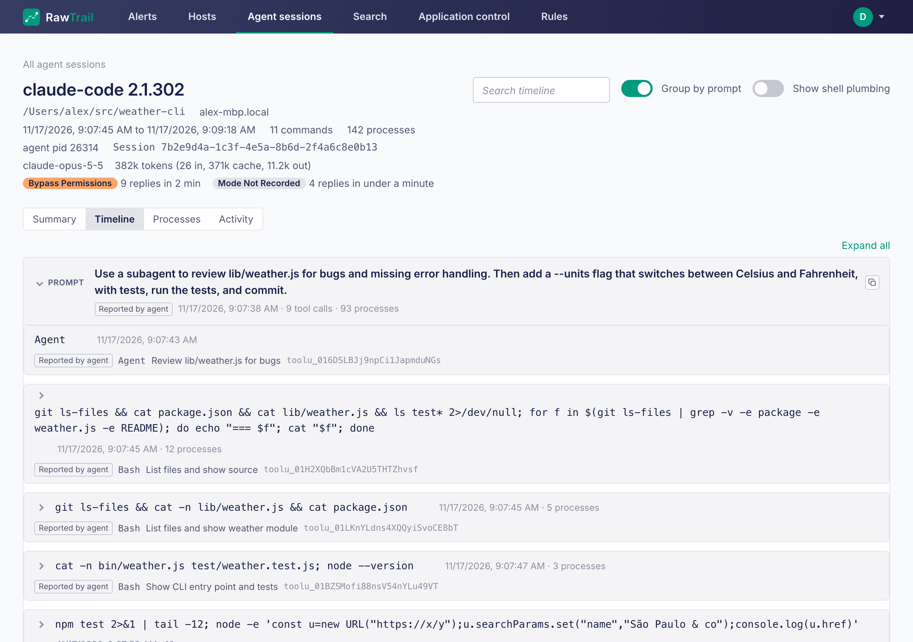

# RawTrail

[](LICENSE) [](https://github.com/rawtrail/rawtrail/releases)

**See what your AI coding agent actually did on your Mac.**

Your agent's log lists the tool calls it made. It doesn't show what those calls did next: one command can start dozens of processes, open your credentials and connect to hosts you never see in the transcript.

RawTrail records that activity on the Mac itself, through macOS Endpoint Security, and ties it to the agent session that caused it.

- **See what actually ran.** The processes, file changes and network connections behind each prompt.
- **Catch credential reads.** An alert when something in the session opens an SSH key or cloud credentials, and in protect mode the read is refused.
- **Keep your data.** On a laptop nothing leaves your Mac. Across a team, the agents report to a server you host.

Open source (MIT) · Apple Silicon, macOS 26+ · Claude Code today, Codex and other agents coming soon

<p align="center">
  
  <br />
  <em>A prompt injection from the demo: the agent's log shows 3 tool calls, the Mac saw 21 processes run, and the credential guard refused a read of an SSH key.</em>
</p>

## Get started

| Path | What you see | You need |
| --- | --- | --- |
| [Watch your own agent](#watch-your-own-agent) | Your Claude Code sessions, live | An Apple Silicon Mac on macOS 26+, Docker |
| [Try the demo](#try-the-demo) | Recorded sessions and alerts in the full UI | Docker on any machine |
| [Deploy it on your Macs](#deploy-it-on-your-macs) | Your team's Macs, live | A Linux server or container host, and an MDM |

### Watch your own agent

Run the server and the agent on your own Mac:

```sh
git clone https://github.com/rawtrail/rawtrail.git
cd rawtrail
scripts/laptop/rawtrail-laptop install
```

The installer opens a link to register your admin passkey. The console then walks you through the approvals macOS asks for, such as allowing RawTrail's system extensions and granting Full Disk Access. Start a Claude Code session and open **Agent sessions**:

- **Summary:** what the agent's log reports beside what the Mac saw run, with a card you can share as an image.
- **Timeline:** each prompt you typed, with the commands and tool calls that followed it, in order.
- **Processes and Activity:** the processes the session started, with their files, connections and DNS lookups.
- **Credential guard:** an alert when a process in the session opens an SSH key, cloud credentials or another watched credential file with anything but that file's own tool, such as `ssh` for a key. In protect mode the read is refused.

<p align="center">
  
</p>

What it records, what it costs and how to remove it: [docs/watch-your-agent.md](docs/watch-your-agent.md).

### Try the demo

Look before installing anything. The demo runs the server, UI and detection pipeline in Docker with data captured on real Macs. It shows recorded activity, not live capture.

```sh
docker compose -f docker-compose.demo.yml up
```

Open <https://localhost:8088/ui/>, accept the self-signed certificate warning, and sign in with `demo@rawtrail.local` / `demo`. You'll find:

- Four Claude Code sessions under **Agent sessions**, two of them stopped by the credential guard.
- Two Mac hosts with full process trees, network and DNS activity, and five ATT&CK detections.

The demo is for evaluation only: it uses checked-in dev secrets, so do not expose it to the internet. What's in it, admin access and building from source: [docs/demo.md](docs/demo.md).

### Deploy it on your Macs

To watch a team's Macs, stand up a server, then push the agent to them.

**1. Stand up the server.**

- **Single VM with your own domain (recommended).** One Linux VM, one script: Caddy gets a Let's Encrypt certificate automatically and reverse-proxies to the server, so you manage no certificates and no content-inspecting edge WAF flags your agents' telemetry as attacks. Full walkthrough: [docs/quickstart-vm.md](docs/quickstart-vm.md).

  ```sh
  EDR_DOMAIN=edr.example.com EDR_VERSION=latest ./bootstrap.sh
  ```

  For production, pin a specific signed release instead of `latest`: see [docs/quickstart-vm.md](docs/quickstart-vm.md).

- **Or self-host the container** on any container host (Docker, Kubernetes, AWS ECS/EKS, GCP, Azure, or your own VM). The server is a standard multi-arch Linux image. Setup, secrets, and TLS: [docs/install-server.md](docs/install-server.md).

**2. Deploy the agent to your Macs** (Apple Silicon, macOS 26+). The agent ships as a Developer ID-signed, notarized `.pkg` plus three `.mobileconfig` profiles, delivered by your MDM.

- **Via MDM** (Jamf, Kandji, Intune, mosyle, Fleet, or any other): the contract and each MDM's steps are in [docs/mdm-deployment.md](docs/mdm-deployment.md).
- **Manually on 1 to 5 Macs** (no MDM, for evaluation): [docs/install-agent-manual.md](docs/install-agent-manual.md).

Once agents enroll, open the server's `/ui/` to watch hosts, process trees, and alerts in real time.

## Beyond AI agents: macOS endpoint security

Agent sessions are built on a full endpoint detection and response (EDR) stack for macOS fleets: real-time process, network and DNS visibility on Apple Silicon Macs, behavioral detection rules run against a materialized process graph, and blocking at exec time. It is fully self-hosted: your own server, your own data, no SaaS dependency.

<p align="center">
  <a href="https://www.youtube.com/watch?v=3pPhDc-AIOQ">
    
  </a>
  <br />
  <a href="https://www.youtube.com/watch?v=3pPhDc-AIOQ"><strong>▶ Watch the EDR demo</strong></a> (recorded before agent sessions)
</p>

- **Real-time macOS monitoring.** On-device extensions capture process execution, fork/exit, file access, DNS queries, and network connections, streamed continuously to your server.
- **Process-graph correlation.** The server reconstructs a live per-host process tree, so every alert carries the full ancestry that led to it.
- **Behavioral detections.** A catalog of rules covering credential access, persistence, privilege escalation, process injection, command-and-control beaconing, and suspicious execution, including detections that correlate exec, DNS, and network together.
- **Application control.** Block execution by binary hash, path, CDHash, signing ID, team ID, or leaf certificate, enforced on the endpoint at exec time.
- **Response.** Kill a running process on a host on demand.
- **Operator UI with RBAC, SSO, and an append-only audit log.** OIDC single sign-on plus a WebAuthn break-glass path, five built-in roles, and an immutable record of every privileged action.

For the full per-release capability list, see the [changelog](CHANGELOG.md).

## How it works

### On-device

- **System extension** (Swift): subscribes to macOS Endpoint Security Framework events (exec, fork, exit, open) and captures process metadata, code-signing info, and file hashes. It also enforces application control and the credential guard.
- **Network extension** (Swift): monitors TCP/UDP connections with process attribution, and resolves DNS to emit per-process `dns_query` events.
- **Agent daemon** (Go): receives events from the extensions over XPC, reads the prompts, tool calls and token usage from Claude Code's session transcripts, buffers everything in a durable SQLite queue, and uploads to the server (store-and-forward, so a transient outage doesn't lose events).

### Server

- **Ingestion API**: accepts event batches from agents over HTTP.
- **Processor**: materializes a per-host process graph from raw events, ties processes to their agent sessions, and runs the detection rules.
- **Storage**: ClickHouse keeps the event archive; MySQL keeps processes, agent sessions, alerts, and commands. The server is stateless (ADR-0010), so it scales as multiple replicas behind a load balancer.
- **Web UI** (React/TypeScript): agent sessions, process-tree visualization, alert management, and response actions.

## Documentation

Operator and reference docs live in [`docs/`](docs/):

| Topic                                                    | Doc                                                                   |
| -------------------------------------------------------- | --------------------------------------------------------------------- |
| Deploy on a single VM with your own domain (recommended) | [`quickstart-vm.md`](docs/quickstart-vm.md)                           |
| Self-host the server stack                               | [`install-server.md`](docs/install-server.md)                         |
| Deploy the agent via any MDM                             | [`mdm-deployment.md`](docs/mdm-deployment.md)                         |
| Evaluate on 1 to 5 Macs without an MDM                   | [`install-agent-manual.md`](docs/install-agent-manual.md)             |
| Watch your own AI agent on your laptop                   | [`watch-your-agent.md`](docs/watch-your-agent.md)                     |
| Run the demo stack                                       | [`demo.md`](docs/demo.md)                                             |
| Day-2 ops: upgrades, rotations, backups, troubleshooting | [`operations.md`](docs/operations.md)                                 |
| Detection rules: behavior, ATT&CK mapping, configuration | [`detection-rules.md`](docs/detection-rules.md)                       |
| HTTP API reference                                       | [`api.md`](docs/api.md) + [`api/openapi.yaml`](docs/api/openapi.yaml) |
| Architecture decisions (the "why")                       | [`adr/`](docs/adr/)                                                   |

The docs in this tree track the development build. For documentation matching a specific release, browse the repository at that release's tag (the [releases page](https://github.com/rawtrail/rawtrail/releases) lists them). How docs are versioned with the code: [`doc-versioning.md`](docs/doc-versioning.md).

Repository layout:

```text
extension/edr/       Swift system extension + network extension (Xcode project)
agent/               Go agent daemon (XPC receiver, SQLite queue, uploader)
server/              Go server (ingestion, processor, detection, REST API)
internal/            Shared packages (envparse, etc.)
ui/                  React/TypeScript frontend (Vite, D3.js process tree)
docs/                Operator + reference docs, ADRs
```

## Development

Building from source or contributing? See [`CONTRIBUTING.md`](CONTRIBUTING.md) for the full guide. The short version:

```bash
mise install        # install pinned tools (Go, Node, golangci-lint, lefthook, task) from .tool-versions
lefthook install    # format + lint on commit, build + tsc on push
task lint:install   # builds the custom golangci-lint (with the commentwrap plugin)

task db:up          # local MySQL on 33306 (dev) / 33307 (test)
task build:ui       # build the UI, embedded into the server binary
task dev:server     # run the server at https://localhost:8088/ui/ (break-glass-only auth)

task test           # everything (Go + UI); requires MySQL
task --list         # the Taskfile is the source of truth for all commands
```

`task dev:server` runs break-glass-only. To exercise SSO locally against the bundled dex IdP, run `task qa:up` then `task dev:server:qa-oidc`; see [`docs/okta-setup.md`](docs/okta-setup.md) for a real OIDC tenant.

## Project health

<!-- Build & quality -->

 [](https://github.com/rawtrail/rawtrail/actions/workflows/test.yml) [](https://sonarcloud.io/summary/new_code?id=rawtrail_rawtrail) [](https://codecov.io/gh/rawtrail/rawtrail)

<!-- Security scanners -->

[](https://github.com/rawtrail/rawtrail/actions/workflows/codeql.yml) [](https://github.com/rawtrail/rawtrail/actions/workflows/go-vulncheck.yml) [](https://github.com/rawtrail/rawtrail/actions/workflows/osv-scanner.yml)

<!-- Supply chain -->

[](https://www.bestpractices.dev/projects/12994) [](https://scorecard.dev/viewer/?uri=github.com/rawtrail/rawtrail) [](https://slsa.dev/spec/v1.0/levels#build-l2) [](docs/best-practices.md#4-supply-chain-security)

## License

[MIT](LICENSE)
